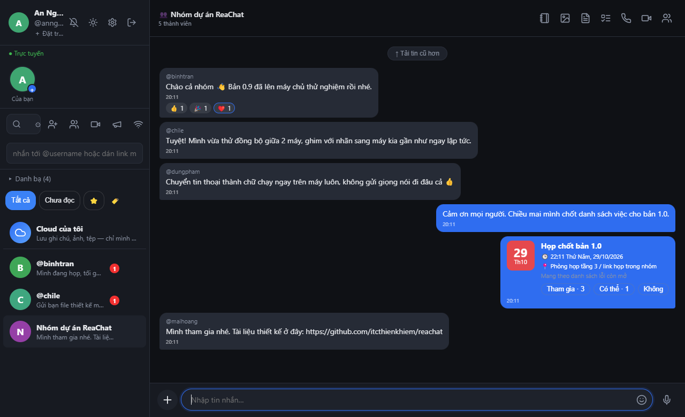

<div align="center">

# ReaChat

**Self-hosted, end-to-end encrypted messaging — desktop, web and calls, on a server you own.**

[](https://github.com/AKSOFT-VN/reachat/actions/workflows/ci.yml)
[](LICENSE)


🇬🇧 English · 🇻🇳 [Tiếng Việt](README.vi.md)



</div>

ReaChat is a complete messaging platform you can run on a single small server: a **Node.js server**, an **Electron desktop app**
for Windows, and an installable **web app (PWA)** for phones and browsers. Messages, files, voice notes and calls are
**end-to-end encrypted** — the server stores and relays ciphertext it cannot read.

> **Status:** actively developed, used in production by a small team. 1:1 chats use the Signal **Double Ratchet**
> (bootstrapped from long-term identity keys — no X3DH prekeys yet). The cryptography is **implemented in this repository
> and has not been independently audited**.
> Read [docs/SECURITY-MODEL.md](docs/SECURITY-MODEL.md) before relying on it for high-risk use.

## Features

**Messaging** — 1:1 and group chats, replies and **threads**, reactions, mentions, edit / recall, pin, forward, polls, **events with RSVP**,
contact cards, stickers and a self-hosted **GIF / sticker library**, image **albums**, **link previews**, drafts, starred messages,
**advanced search** (runs locally over decrypted messages), scheduled and conditional send, disappearing messages, view-once images.

**Calls** — 1:1 and group voice/video (WebRTC mesh, up to 6), screen sharing, local call recording, built-in TURN server or
Cloudflare TURN with per-call credentials and a monthly bandwidth cap.

**Files** — chunked, resumable uploads with no size limit, encrypted per file; direct **peer-to-peer** transfer that never touches the server.

**Privacy & security** — Double Ratchet for 1:1 chats, rotating group keys, safety numbers, sealed call signalling, encrypted key backup,
**2FA (TOTP)**, recovery codes, password reset by email / SMS, device & session management, self-service account deletion,
hide online status / read receipts, **app lock with PIN**, screenshot protection for sensitive chats.

**Sync across devices** — pinned / muted / archived chats, labels, drafts, starred messages — stored as one document
**encrypted with the user's own key**.

**On-device intelligence** — **voice-to-text** with Whisper running locally (WebAssembly; audio never leaves the device),
chat summaries, scam-message warnings. Optional message translation (explicit opt-in, leaves E2E for that message).

**Social** — friend requests, QR codes, friend search with privacy controls, 24-hour stories, profiles with bio / birthday / cover,
custom status with auto-reply, public channels, group roles (owner, deputies), join approval, admin-only groups, invite links,
meeting rooms, bot API with webhooks.

**Operations** — admin dashboard (stats, reports, user moderation, keyword / domain filters, audit log, slow-query monitor),
captcha and per-IP registration limits, Google sign-in, Web Push, auto-update for the desktop app, health endpoint and
alerting (webhook / email), backups, **one-command release & deploy** with an automated UI smoke test and automatic rollback.

The user interface is in **Vietnamese and English**.

## Quick start (development)

Requirements: **Node.js 24**, npm 10, and a C/C++ toolchain for `better-sqlite3` if no prebuilt binary is available for your platform.

```bash
git clone https://github.com/AKSOFT-VN/reachat.git
cd reachat
npm install
npm run seed            # demo accounts: nam / binh (password 123456) — development only
npm run dev:server      # server on http://localhost:4000
npm run dev:desktop     # desktop app (Vite + Electron) in another terminal
```

The web app is served by the server at `http://localhost:4000/app` after `npm --workspace desktop run build`.

## Self-hosting

ReaChat runs as **one Docker container** with a single data volume (SQLite database, uploaded files, keys, update packages).
Put it behind any TLS reverse proxy (nginx, Caddy, Cloudflare Tunnel…).

- Step-by-step guide: **[docs/SELF-HOSTING.md](docs/SELF-HOSTING.md)**
- Every environment variable: **[docs/CONFIGURATION.md](docs/CONFIGURATION.md)** (template: [`server/.env.example`](server/.env.example))
- Releasing your own builds: **[docs/RELEASING.md](docs/RELEASING.md)**

## Architecture

```
┌───────────────────────────┐      HTTPS / WSS       ┌───────────────────────────────────────┐
│ Desktop (Electron + React)│ ─────────────────────▶ │ Server (Node.js, Express, ws)         │
│ Web / PWA (same React UI) │   REST + WebSocket     │  · relays ciphertext, never plaintext │
│  · keys never leave device│                        │  · SQLite (WAL) · files · Web Push    │
│  · local message cache    │ ◀─ WebRTC (P2P/TURN) ─▶│  · built-in TURN / Cloudflare TURN    │
└───────────────────────────┘                        └───────────────────────────────────────┘
```

Details: [docs/ARCHITECTURE.md](docs/ARCHITECTURE.md).

| Path | What |
|---|---|
| `server/` | Node.js server: REST + WebSocket, SQLite, TURN, push, admin, bots — tests in `server/test/` |
| `desktop/` | Electron main process (`electron/`) + React UI (`src/`) shared by desktop and web |
| `deploy/` | Dockerfile and the remote deploy script (backup → build → run → health check → rollback) |
| `scripts/` | `release.mjs` (one-command release) and `smoke-ui.mjs` (automated UI test of the built app) |
| `docs/` | Architecture, security model, self-hosting, configuration, releasing |

## Testing

```bash
npm test                # 19 server suites (each spawns its own temporary server) + desktop unit tests
npm run smoke-ui        # drives the built desktop app: login, reloads, settings, sending a message
```

## Roadmap

Native iOS / Android apps · SFU for large meetings · communities · passkeys · PostgreSQL backend for multi-server deployments ·
migration to libsignal and an independent security audit. Ideas and help are welcome — see [CONTRIBUTING.md](CONTRIBUTING.md).

## Contributing

Contributions are welcome! Please read [CONTRIBUTING.md](CONTRIBUTING.md) and our [Code of Conduct](CODE_OF_CONDUCT.md).
**Security issues must not be reported in public issues** — see [SECURITY.md](SECURITY.md).

## License

Copyright © 2026 aksoft.vn. Licensed under the [Apache License, Version 2.0](LICENSE). See [NOTICE](NOTICE) for attributions.
